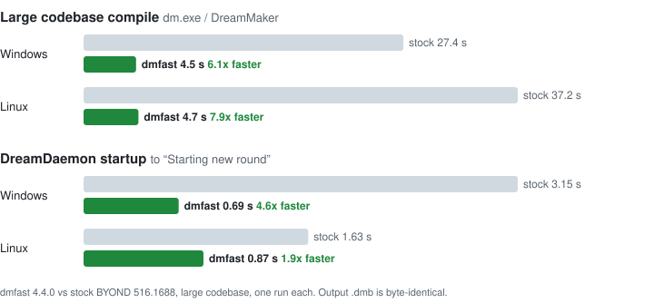

# dmfast

Robusts BYOND's compiler.

<picture>
  <source media="(prefers-color-scheme: dark)" srcset="docs/speedup-dark.svg">
  
</picture>

How much faster depends on the computer. Some real compiles: 2 min to 20 s, 60 s to 12 s, 27 s to 10 s.

## Supported BYOND versions

| BYOND | Windows | Linux |
|---|---|---|
| 516.1665 and newer (tested up to 516.1688) | all patches | all patches |
| 516.1660 | all patches | all but the name filter |
| 516.1648 - 516.1655 | all but the progress poll | some patches off |
| 515.1647 | most patches | some patches off |

Patches that don't match a build disable themselves, so older builds are just less sped up.

## Install

Download `dmfast-install.exe` from [Releases](https://github.com/blue-tarpaulin/dmfast/releases).

Close BYOND, then:

```
dmfast-install.exe "C:\Program Files (x86)\BYOND\bin"
```

The same file installs on Linux:

```
sh dmfast-install.exe ~/byond/bin
```

The path is your BYOND `bin` folder (or `dm.exe` in it) - dragging onto the exe works too.

Run it with no arguments for help. Re-run after BYOND updates.

Add `--runtime` to also speed up DreamDaemon (worlds load about 4x faster on Windows, 2x on Linux).

Installing again without `--runtime` puts back the stock DreamDaemon.

## Uninstall

You can delete the modified compiler and rename the `_orig` one, or for a full uninstall:

```
dmfast-install.exe --uninstall "C:\Program Files (x86)\BYOND\bin"
```

On Linux: `sh dmfast-install.exe --uninstall ~/byond/bin`.

## Check it's on

```
set DMFAST_STATS=1
dm.exe yourgame.dme
```

Anything that doesn't match your BYOND version prints `disabled` and runs stock.

## Build

See [CONTRIBUTING.md](CONTRIBUTING.md).
