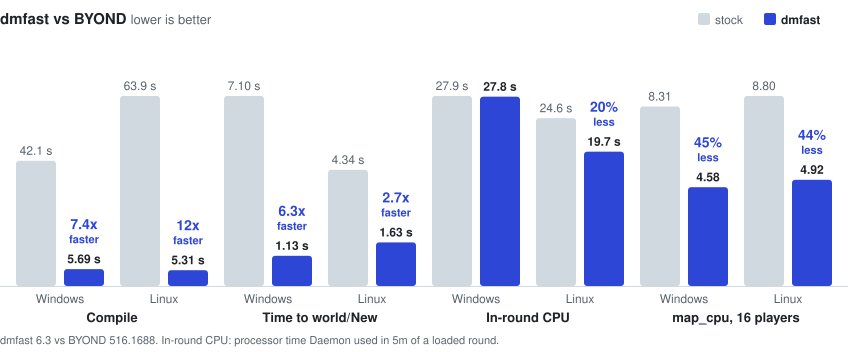

Robusts BYOND's toolchain.

<picture>
  <source media="(prefers-color-scheme: dark)" srcset="docs/speedup-66d6f07d-dark.svg">
  
</picture>

How much faster depends on your computer and codebase, but expect significant gains.

Supports BYOND 515 and 516. Patches that don't work will disable themselves automatically.

## Install

Download `dmfast-install.exe` from [Releases](https://github.com/blue-tarpaulin/dmfast/releases).

Close BYOND, then double-click `dmfast-install.exe`.

It'll find BYOND and walk you through the setup, or you can drag your BYOND install on top of it. 

From a terminal (the same file works on Linux):
```shell
dmfast-install.exe "C:\Program Files (x86)\BYOND"
sh dmfast-install.exe ~/byond
```

To turn on the opt-in [bug fixes](BUGFIXES.md), pass `--fixes safe` or `--fixes extended`.

Run it bare via terminal for more commands and help. Re-run it after BYOND updates.

## Uninstall

Double-click the installer again and choose remove, or:

```shell
dmfast-install.exe --uninstall "C:\Program Files (x86)\BYOND"
sh dmfast-install.exe --uninstall ~/byond
```

You can also delete each modified program and rename its `_orig` copy back.

## Check it's working

You can just run the compiler as normal (there's a banner message), or:

```
set DMFAST_STATS=1
dm.exe yourgame.dme
```

To turn patches off, set `DMFAST_DISABLE` to their keys from [PATCHES.md](PATCHES.md), comma-separated.

## Build

See [CONTRIBUTING.md](CONTRIBUTING.md).

## License

dmfast is licensed under the BSD 3-Clause License, © 2026 Greytide Worldwide; see [LICENSE](LICENSE).

It bundles [mimalloc](https://github.com/microsoft/mimalloc) (MIT, Microsoft Corporation & Daan Leijen - [vendor/mimalloc-x86/LICENSE.txt](vendor/mimalloc-x86/LICENSE.txt)).

dmfast patches your own installed copy of BYOND in memory while it runs. 
The installer only makes the BYOND programs load dmfast and keeps their originals, so uninstalling restores stock BYOND. Output is identical to the stock versions (unless opted in to bugfixes).

This repository contains no BYOND code or binaries. dmfast is not affiliated with or endorsed by BYOND in any way.

We offer no guarantees or warranty, but every release is checked against stock BYOND for identical output.

If something breaks, please [open an issue](https://github.com/blue-tarpaulin/dmfast/issues).
