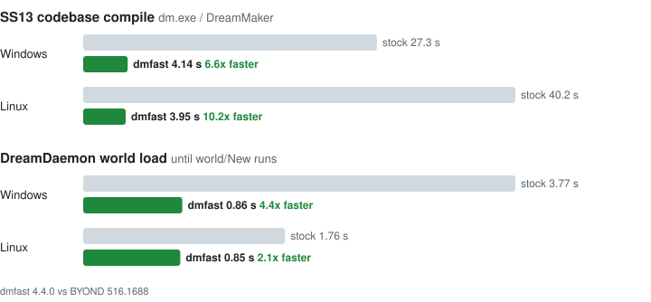

# dmfast

Robusts BYOND's compiler.

<picture>
  <source media="(prefers-color-scheme: dark)" srcset="docs/speedup-de113620-dark.svg">
  
</picture>

How much faster depends on the computer and codebase, but expect significant gains.

Byond 515 and 516 are supported. Patches that don't work will just disable themselves.

## Install

Download `dmfast-install.exe` from [Releases](https://github.com/blue-tarpaulin/dmfast/releases).

Close BYOND, then:

```
dmfast-install.exe "C:\Program Files (x86)\BYOND\bin"
```

The same file installs on Linux:

```
sh dmfast-install.exe ~/byond/bin
```

The path is your BYOND `bin` folder (or `dm.exe` in it) - dragging onto the exe works too.

Run it with no arguments for help. Re-run after BYOND updates.

Add `--runtime` to also speed up DreamDaemon:

```
dmfast-install.exe --runtime "C:\Program Files (x86)\BYOND\bin"
```

Installing again without `--runtime` puts back the stock DreamDaemon.

## Uninstall

You can delete each modified program and rename the `_orig` copy back, or for a full uninstall:

```
dmfast-install.exe --uninstall "C:\Program Files (x86)\BYOND\bin"
```

On Linux: `sh dmfast-install.exe --uninstall ~/byond/bin`.

## Check it's on

```
set DMFAST_STATS=1
dm.exe yourgame.dme
```

Anything that's not working prints `disabled` and runs stock.

## Build

See [CONTRIBUTING.md](CONTRIBUTING.md).
